# Linking USPTO patent inventors to U.S. census individuals

This repository contains the record-linkage pipeline that matches historical USPTO
patent inventors (1840–1950) to individuals in the U.S. decennial census
(1850–1940, excluding the 1890 wave, destroyed by fire). It accompanies a (submitted) *Scientific Data*
descriptor; the linked dataset is archived on Zenodo
(<https://doi.org/10.5281/zenodo.21078984>).

The pipeline is organised as the **six steps** of the descriptor's Methods section,
preceded by a census pre-cleaning stage:

1. **Blocking & candidate identification** — over-generate a broad candidate pool
   per inventor with four complementary name-matching algorithms, restricted by
   gender, a ±10-year window, and geography.
2. **Filtering** — drop clearly implausible candidates with thirteen rule-based
   filters.
3. **Building the training dataset** — combine the manually-verified ground truth
   with two kinds of answer-absent negatives (orphans and deceased "hard negatives")
   into a labeled training set.
4. **Building features** — construct 25 features in six groups (string similarity,
   geographic distance, age at patenting, occupational relevance, semantic
   technology↔occupation relatedness, and name distinctiveness).
5. **Predicting the most likely true match** — train a random-forest classifier (XGBoost /
   SVC selectable) and keep, per inventor–wave, the single highest-probability census
   match.
6. **Post-match CTP consistency annotation & supplementation** — cross-check the links
   against the Census Tree Project crosswalks, flag cross-wave inconsistencies, and
   supplement eligible waves the model missed (non-destructive: predictions are kept).

## Pipeline map

The core pipeline is a linear chain (Step 0 → 6) into which three optional feature/label
add-ons feed at Step 3–4:

<p align="center"></p>

### Steps 1 & 2 detailed: Blocking & candidate identification

Step 1 runs **four complementary name-matching algorithms** in parallel across geographic scopes (county, state, nationwide), then merges the results. Each method processes one census year × one gender × one geographic scope per invocation:

<p align="center"></p>

### Step 3 detailed: Building the training dataset

Step 3 combines **ground truth** (manually-verified matches) with two types of **answer-absent negatives** to create a labeled training set. This teaches the classifier to reject as well as rank:

<p align="center"></p>

### Step 4 detailed: Building features

Step 4 assembles **25 features in 6 groups** from Step 2's output plus three add-on computations. The add-ons (relatedness, name rarity, deceased negatives) run in parallel and feed into the feature merge:

<p align="center"></p>

### Step 5 detailed: Predicting the most likely true match

Step 5 trains a classifier on labeled data, then scores all candidates and selects the single best match per patent-inventor per census wave:

<p align="center"></p>

Plain-text version of the same map (script order by file prefix):

```
(pre)  pre-clean census names ......... 0_preclean_census.py
Step 1 BLOCKING (candidate generation)
         county cosine ............... 1a_block_faiss_cosine.py
         county + state Levenshtein .. 1b_block_rapidfuzz_levenshtein.py
         nationwide cosine (IVF-PQ) .. 1c_block_faiss_cosine_country.py
         collect + deduplicate ....... 2a_collect_candidates.py   (folds in all four sources)
Step 2 FILTER (13-filter cascade) ..... 2b_refine_filter.py
Step 3 TRAINING DATASET
         deceased hard negatives ..... golden_negatives/  (not distributed; its output is deposited)
         merge + wire labels ......... 3_merge_features.py --deceased-negatives
         label + tag groups .......... ml_model/1_build_training.py  (patinv_type)
Step 4 FEATURES (25 features, 6 groups)
         semantic relatedness ........ relatedness/1..4   (JobBERT-v2)
         surname rarity .............. name_rarity/1_surname_rarity.py
         merge feature sources ....... 3_merge_features.py
         publication projection ...... 4_select_ml_columns.py   (Zenodo deposit table)
Step 5 PREDICT
         train / predict ............. ml_model/2_train_classifier.py -> 3_predict.py
Step 6 CTP consistency + supplement ... ml_model/4_ctp_correction.py   (non-destructive: annotate + supplement)
```

Blocking (Step 1) is deliberately high-recall: it over-generates candidates cheaply
across four similarity notions and three geographic scopes (county, state, nationwide).
Steps 2–5 then filter, featurise, and score those candidates; the default classifier
is a **random forest**, with XGBoost and SVC available as alternatives.

## Contents

| Path                                                            | Purpose                                                                                                                                                                                                                                                                                                                                                                                                                                                                                                 |
| --------------------------------------------------------------- | ------------------------------------------------------------------------------------------------------------------------------------------------------------------------------------------------------------------------------------------------------------------------------------------------------------------------------------------------------------------------------------------------------------------------------------------------------------------------------------------------------- |
| `0_preclean_census.py`                                          | Pre-clean: raw IPUMS person/household files → cleaned per-year census parquet.                                                                                                                                                                                                                                                                                                                                                                                                                          |
| `1a_block_faiss_cosine.py`                                      | Step 1: candidate generation by TF-IDF + FAISS nearest-neighbour cosine (county).                                                                                                                                                                                                                                                                                                                                                                                                                       |
| `1b_block_rapidfuzz_levenshtein.py`                             | Step 1: candidate generation by RapidFuzz normalized Levenshtein (+ token-sort) (county / state).                                                                                                                                                                                                                                                                                                                                                                                                       |
| `1c_block_faiss_cosine_country.py`                              | Step 1: nationwide cosine via FAISS IVF-PQ — recovers cross-state movers; folded into `2a` by default.                                                                                                                                                                                                                                                                                                                                                                                                  |
| `2a_collect_candidates.py`                                      | Step 1 (polars): merge + deduplicate the four blocking sources into one candidate table.                                                                                                                                                                                                                                                                                                                                                                                                                |
| `2b_refine_filter.py`                                           | Step 2 (polars): name metrics + 13-filter cascade + census/geo enrichment → `matched_candidates`.                                                                                                                                                                                                                                                                                                                                                                                                       |
| `3_merge_features.py`                                           | Steps 3–4 (polars): concat relatedness, attach surname rarity + `n_candidates`, wire deceased hard negatives.                                                                                                                                                                                                                                                                                                                                                                                           |
| `4_select_ml_columns.py`                                        | Step 4: project the feature table to the ML/publication column subset (drops names, precomputes `diff_length`) — the Zenodo deposit table.                                                                                                                                                                                                                                                                                                                                                              |
| `blocking_common.py` / `collect_common.py` / `refine_common.py` | Shared cores for Steps 1–2 (name cleaning, loaders, the 13 filters, enrichment).                                                                                                                                                                                                                                                                                                                                                                                                                        |
| `relatedness/`                                                  | Step 4 add-on: JobBERT-v2 patent↔occupation semantic relatedness (`relatedness_short` / `relatedness_long`).                                                                                                                                                                                                                                                                                                                                                                                            |
| `name_rarity/`                                                  | Step 4 add-on: per-wave surname rarity reference (`surname_logfreq`).                                                                                                                                                                                                                                                                                                                                                                                                                                   |
| `golden_negatives/`                                             | Step 3 add-on: identify inventors reported deceased on their own patents → provable hard negatives. **Not distributed in this repository** — its reviewed output is deposited on Zenodo (`deceased_inventors.csv`).                                                                                                                                                                                                                                                                                     |
| `executor_validation/`                                          | Optional add-on: out-of-sample executor-spouse concordance — an independent precision check on the model's links. **Not distributed in this repository** (see *Validation* below).                                                                                                                                                                                                                                                                                                                      |
| `ml_model/`                                                     | Steps 3, 5 & 6: build the training table, train the classifier, predict, and apply the CTP consistency annotation + supplementation (`4_ctp_correction.py`).                                                                                                                                                                                                                                                                                                                                            |
| `technical_validation/`                                         | Paper-analysis add-on: regenerate the descriptor's Technical-Validation tables/figures. Scripts are numbered in the order their output appears in the manuscript: `1_data_overview_figure`, `2_ctp_famtree_pairs`, `3_ctp_consistency`, and the widow–spouse validation pair `4_relative_attach`→`5_relative_report` (the attach stage records all household relatives as the audit trail; the report scores the widow–spouse comparison only). Not a pipeline stage; see *Technical Validation* below. |
| `environment.yml`                                               | Reproducible conda environment (authoritative).                                                                                                                                                                                                                                                                                                                                                                                                                                                         |
| `tests/`                                                        | Smoke tests for the core pipeline and its feature add-ons (see *Testing*).                                                                                                                                                                                                                                                                                                                                                                                                                              |

## Data requirements

Some inputs are public; several are **restricted IPUMS USA extracts and are not
distributed with this code.** All paths are CLI arguments — nothing is hardcoded.

1. **Patent inventors (public).**
   `USPTO_patent_inventors_1840_1950.tsv` — the patent-inventor table published with
   this paper. Tab-separated, one row per patent–inventor pair, columns:
   `PatInvID, pubnumber, progr, pubdate, pubyear, name, citizen, country, state,
   county, city, FIPS, gender`.

2. **Cleaned census (restricted).**
   Per-year parquet files (e.g. `US1850P.parquet`) with columns
   `histid, clean_fn, clean_ln, county_fips_code, age, birthyr, sex, city,
   potential_match`. Produced from **IPUMS USA full-count microdata** by
   `0_preclean_census.py`. The microdata are restricted by the IPUMS terms of use and
   **cannot be redistributed**; obtain an extract from <https://usa.ipums.org/>.

3. **Supporting inputs for Steps 2–4** (provided separately / restricted as noted):
   county-distance crosswalks (NBER County Distance Database, `.csv.zip`); the
   ground-truth sample `ground_truth.csv`; and patent title/class tables with
   USPC/NBER name lookups for the relatedness add-on.

> **Scope note.** The public inventor table is U.S.-only (`country = UNITED STATES`).
> The project's internal "no-country" matching variants — which match inventors whose
> country of residence is unknown — are **not reproducible from the public deposit and
> are not included here.** This is unrelated to the nationwide `1c` blocking (which *is*
> part of the published method).

## Installation

```bash
conda env create -f environment.yml
conda activate ipums_match
```

Tested with Python 3.10, `faiss-gpu` 1.12.0, pandas 2.3.3, numpy 2.2.5, pyarrow
23.0.1, polars 1.41.2, scikit-learn 1.7.2, rapidfuzz 3.14.3, metaphone 0.6. Steps 1–2
are implemented in **polars** for speed and bounded-memory streaming over the large
candidate tables (≈16–19× faster than pandas merges, with byte-identical
output).

- **GPU vs CPU.** `1a`/`1c` default to GPU (`--device gpu`, requires a CUDA GPU and
  `faiss-gpu`). Pass `--device cpu` to run anywhere; the CPU index returns identical
  results, only slower. If you will only ever run on CPU, install `faiss-cpu` instead.
- **Add-on dependencies.** The environment above already includes everything the
  add-ons need: `sentence-transformers` (with `torch`) for the relatedness add-on's
  JobBERT-v2 model (`TechWolf/JobBERT-v2`; run its embedding stage on CPU,
  `--device cpu`), `xgboost` for `--model xgb`, and `matplotlib`/`openpyxl` for the
  reports and figures — no separate install is required.

## Pre-cleaning the census

`0_preclean_census.py` produces the cleaned census parquet that blocking reads. Run it
**once per census year**: it reads the raw IPUMS person file, attaches the city from
the matching household file, normalises first/last names (`clean_fn` / `clean_ln`),
attaches the 5-digit county FIPS from a geographic crosswalk, and writes the schema in
*Data requirements* above.

```bash
python 0_preclean_census.py \
    --person     census/US1900P.parquet \
    --household  census/US1900H.parquet \
    --crosswalk  geo_census_crosswalk/1900_csv.zip \
    --output     cleaned_census/US1900P.parquet
```

| Argument           | Meaning                                                                                             |
| ------------------ | --------------------------------------------------------------------------------------------------- |
| `--person PATH`    | Raw IPUMS person parquet: `histid, namefrst, namelast, age, birthyr, sex, serialp`.                 |
| `--household PATH` | Raw IPUMS household parquet: `serial, city`.                                                        |
| `--crosswalk PATH` | Geographic crosswalk CSV/zip: `histid, state_fips_geomatch, county_fips_geomatch, potential_match`. |
| `--output PATH`    | Output cleaned parquet.                                                                             |
| `--n-cores N`      | Processes for parallel name cleaning.                                                               |

All three inputs are restricted IPUMS USA extracts.

## Step 1 — Blocking & candidate identification

Blocking restricts comparisons by **gender**, a **±10-year** publication window, and
**geography**, then applies four complementary name-matching algorithms to assemble a
broad candidate pool per patent-inventor. The blocking scripts (`1a`/`1b`/`1c`) each
process **one census year × one gender × one geographic scope** per invocation and
write a single parquet; `2a` then merges them.

```bash
# 1a — FAISS cosine, county blocking, males, 1900 (GPU)
python 1a_block_faiss_cosine.py \
    --inventors USPTO_patent_inventors_1840_1950.tsv \
    --census    cleaned_census/US1900P.parquet \
    --census-year 1900 --gender M --geo-level county \
    --device gpu --output-dir ./blocking_out

# 1b — RapidFuzz Levenshtein, state blocking, females, 1900
python 1b_block_rapidfuzz_levenshtein.py \
    --inventors USPTO_patent_inventors_1840_1950.tsv \
    --census    cleaned_census/US1900P.parquet \
    --census-year 1900 --gender F --geo-level state \
    --output-dir ./blocking_out

# 1c — nationwide FAISS IVF-PQ cosine (all genders), 1900
python 1c_block_faiss_cosine_country.py \
    --inventors USPTO_patent_inventors_1840_1950.tsv \
    --census    cleaned_census/US1900P.parquet \
    --census-year 1900 --genders M F U \
    --device gpu --output-dir ./blocking_out
```

### Key arguments (`1a` / `1b`)

| Argument                     | Meaning                                                                     |
| ---------------------------- | --------------------------------------------------------------------------- |
| `--inventors PATH`           | Published patent-inventor TSV.                                              |
| `--census PATH`              | One cleaned census parquet (single year).                                   |
| `--census-year INT`          | Census year. Selects patents within a ±10-year window and names the output. |
| `--gender {M,F,U}`           | Inventor gender. `M`→census sex 1, `F`→sex 2, `U`→either.                   |
| `--geo-level {county,state}` | Geographic blocking key.                                                    |
| `--output-dir PATH`          | Output directory (created if absent).                                       |
| `--max-counties N`           | Process at most N geographic buckets — for quick tests.                     |
| `--n-cores N`                | Processes for parallel name cleaning.                                       |

`1a`-only: `--device {gpu,cpu}`, `--k` (neighbours, default 30), `--batch-size`.
`1b`-only: `--score-cutoff` (max normalized Levenshtein distance, default 0.2),
`--limit` (candidates per name; per-geo default below), `--token-sort` /
`--no-token-sort`, `--token-sort-cutoff` (default 90), `--max-workers`.
`1c` drops geography (nationwide; `geo_key = "US"`) and adds IVF-PQ index knobs
(`--k` default 50, `--svd-dim`, `--pq-m`, `--nlist`, `--nprobe`, …) and takes
`--genders` (list) rather than a single `--gender`.

### Production configuration

The published matches were produced by running, for **each gender (M, F, U)** and
**each census year (1850–1940, excluding 1890)**, the four blocking sources that `2a`
collects by default:

| Source             | Script                              | Scope   | Levenshtein `--limit` | token-sort |
| ------------------ | ----------------------------------- | ------- | --------------------- | ---------- |
| county cosine      | `1a_block_faiss_cosine.py`          | county  | –                     | –          |
| county Levenshtein | `1b_block_rapidfuzz_levenshtein.py` | county  | 500                   | off        |
| state Levenshtein  | `1b_block_rapidfuzz_levenshtein.py` | state   | 250                   | on         |
| nationwide cosine  | `1c_block_faiss_cosine_country.py`  | US-wide | –                     | –          |

The `--limit` / token-sort values are the **defaults** selected automatically by
`--geo-level`. County catches local name variants; state also catches inventors who
moved within a state; the nationwide IVF-PQ pass (`1c`) recovers cross-state movers and
guarantees a floor of candidates per inventor.

### Collect + deduplicate (`2a`)

`2a_collect_candidates.py` merges the blocking outputs for one year into a single
candidate table. `--sources` defaults to all four
(`cosine_county, leven_county, leven_state, cosine_country`); drop one by omitting it.

```bash
python 2a_collect_candidates.py \
    --blocking-dir ./blocking_out \
    --census-year 1900 --genders M F U \
    --output ./stage2/candidates_1900.parquet
```

**Cosine and Levenshtein are not comparable, and are never compared.** "Best score" is
taken *within each metric*: cosine by `max` (higher = more similar) and normalized
Levenshtein *distance* by `min` (lower = more similar), kept as separate `cosine_score`
/ `levenshtein_score` columns. They assemble the union of candidate pairs only — **Step
2 recomputes its own similarity features and drops both blocking scores**, so they are a
recall device, not classifier inputs. Because `1c` recomputes an exact cosine in
[−1, 1], `cosine_score` may be **negative**; this has no downstream effect.

### Blocking output schema

Each `1a`/`1b`/`1c` run writes one gzip-compressed parquet
(`cosine_match_{geo}_{year}_{g}`, `levenshtein_match_{geo}_{year}_{g}`,
`cosine_match_country_{year}_{g}`) with columns `inventor_name`, `census_name`, the
metric column (`Cosine_Similarity` in [−1, 1] / `score` normalized Levenshtein in
[0, 1] / `token_sort` in [0, 100] for state Levenshtein), `PatInvID`, `pubnumber`,
`histid`, `census_year`, `geo_key`.

## Step 2 — Filtering

`2b_refine_filter.py` turns the collected candidates into the `matched_candidates`
feature table: it normalises names, computes `leven_norm`, `tkratio`, `tksortratio`
(double-metaphone agreement and token counts are computed for the filters but not
kept), applies the **13-filter cascade** (`refine_common.FILTERS`), then joins patent
geography, census geography/demographics, occupation variables, and the inter-county
`county_distance`.

```bash
python 2b_refine_filter.py \
    --candidates           ./stage2/candidates_1900.parquet \
    --inventors            USPTO_patent_inventors_1840_1950.tsv \
    --cleaned-census       cleaned_census/US1900P.parquet \
    --raw-census           census/US1900P.parquet \
    --household-census     census/US1900H.parquet \
    --county-distances-dir county_distance_crosswalks \
    --census-year 1900 \
    --output ./stage2/matched_candidates_1900.parquet \
    --golden ground_truth.csv
```

The 13 filters are `filter0 … filter12` in `refine_common.FILTERS`, each a conjunctive
removal keyed on the `(inventor_name, census_name)` pair — so the cascade is
order-independent **except `filter9`** (the record-level age cut, `pubyear − birthyr ∈
[18, 80]`). Filter 0 (all three string metrics weak) removes by far the most candidates;
see paper Table 5 for per-filter descriptions and cumulative counts.

`county_distance` is recovered two ways: (1) `--county-distances-dir` is read as a
**priority cascade** over every crosswalk `.csv.zip` it contains (first source carrying
a `(county1, county2)` pair wins; `gaz1990…500miles` primary; Shannon County SD
`46113→46102` remap); and (2) a **household-file fallback** reconstructs the enumeration
county from the IPUMS household file (`statefip` + `countyicp → FIPS`) where stage-0's
probabilistic place geomatch left `county_census` null (~16% in 1850, ~5% in 1900 — the
sole cause of a missing distance). `--missing-distance-out` optionally writes the
residual no-distance rows for inspection.

`--golden` adds two label columns: `true_histid` (the correct histid for ground-truth
patent-inventors, else null) and `true_match` (1 = true match, 0 = competing candidate
of a ground-truth patent-inventor, null = not in the ground truth).

How many manually-verified ground-truth matches survive blocking and each filter —
and to which step the losses accrue — is reported in the descriptor's Technical
Validation (the per-filter volume and ground-truth recall tables).

### Running all census years

`2a` and `2b` each process **one census year per call** (years run
independently or in parallel). To cover the full study period, invoke each once per
standard census year (`1850 1860 1870 1880 1900 1910 1920 1930 1940`, skipping 1890),
pointing `--census-year` and the per-year census paths at each wave. If a single
combined table is wanted, concatenate the per-year parquets yourself (unioning columns,
since per-year schemas differ — e.g. `occ`/`occstr`/`lit`).

## Step 3 — Building the training dataset

The training set combines the manually-verified **ground truth** (confirmed
patent-inventor ↔ census matches, from *American Men of Science* and Wikipedia) with two
sources of **answer-absent negatives**, so the classifier learns to *reject* as well as
rank:

- **Orphans** — ground-truth groups whose true match was lost upstream (blocking/filtering);
  only competing incorrect candidates survive.
- **Deceased hard negatives** — inventors reported as *deceased* on their own patent
  cannot appear in any later census, so every candidate in a post-death wave is a
  provable non-match. The `golden_negatives/` add-on (an OCR/LLM mining + human-review
  workflow; **not distributed in this repository**) produced the reviewed list of such
  inventors — deposited on Zenodo as `deceased_inventors.csv` — which is wired into the
  feature table at Step 3.

`3_merge_features.py` wires the reviewed hard negatives into the feature table via
`--deceased-negatives` (per eligible wave, each such candidate is flipped to
`true_match=0` and flagged `is_hard_negative=1`, collision-safe against ground-truth labels).
`ml_model/1_build_training.py` then filters to the labeled rows and **tags** each
`(PatInvID, pubnumber, census_year)` group with `patinv_type ∈ {matched, orphan,
hard_negative}`, keeping all three (`is_hard_negative` / `patinv_type` are label-source
columns, never model features). `ml_model/1b_build_training_nonames.py` is a name-free
variant that ships `diff_length` in place of the raw name strings.

## Step 4 — Building features

The classifier consumes **25 features in six groups**; see the paper's feature-summary
table for the full list. They are assembled from Step 2's output plus two add-ons and
merged by `3_merge_features.py`:

- **String similarity** — `leven_simil`, `tkratio`, `tksortratio`, their interaction
  `inter`, and `diff_length` (absolute name-length gap).
- **Geographic distance** — `county_distance` (miles between patent and census county).
- **Age at patenting** — `age_at_pat` (patent year − birth year).
- **Occupational relevance** — 14 binary indicators from census IND1950 / OCC1950 /
  occupation-string matches against curated technology lists.
- **Semantic relatedness** — `relatedness_short` / `relatedness_long`, cosine similarity
  between patent-description and census-occupation embeddings from **JobBERT-v2**
  (`relatedness/` add-on: Stage 1 builds per-patent strings → 2 attaches occupation +
  patent strings per year → 3 embeds with JobBERT-v2 → 4 scores cosine per year).
- **Name distinctiveness** — `surname_logfreq = −log₁₀(n/N)` (rarer surname → higher),
  from the `name_rarity/` add-on; plus the candidate-pool-size feature `n_candidates`.

The two feature add-ons are run first (all paths are CLI arguments). The
**relatedness** add-on is four chained per-year stages over the Step-2 output:

```bash
# 1 — per-patent text strings (title / title+USPC+NBER names)
python src/relatedness/1_patent_strings.py \
    --titles  USPTO_patent_titles_1840_1950.zip \
    --classes USPTO_patent_classes_1840_1950.zip \
    --uspc-names uspc_class_names.xlsx --nber-names nber_category.txt \
    --output  ./relatedness_out/patent_strings.parquet

# 2 — attach occupation + patent strings to the Step-2 candidates, per year
python src/relatedness/2_build_strings.py \
    --matched-candidates ./stage2/matched_candidates \
    --patent-strings     ./relatedness_out/patent_strings.parquet \
    --occ1950 OCC1950.xlsx --ind1950 IND1950.xlsx \
    --output-dir         ./relatedness_out/with_strings

# 3 — JobBERT-v2 embeddings (CPU)
python src/relatedness/3_create_embeddings.py \
    --patent-strings   ./relatedness_out/patent_strings.parquet \
    --with-strings-dir ./relatedness_out/with_strings \
    --out-dir          ./relatedness_out/embeddings \
    --device cpu

# 4 — cosine scores
python src/relatedness/4_relatedness_score.py \
    --input          ./relatedness_out/with_strings \
    --embeddings-dir ./relatedness_out/embeddings \
    --out-dir        ./relatedness_out/by_year
```

The **name-rarity** reference is a single script, run once per census wave:

```bash
python src/name_rarity/1_surname_rarity.py \
    --cleaned-census cleaned_census/US1900P.parquet \
    --census-year 1900 \
    --output ./name_rarity_out/surname_rarity_1900.parquet
```

`3_merge_features.py` then concatenates the per-year relatedness outputs and attaches
`surname_logfreq` + `n_candidates`:

```bash
python 3_merge_features.py \
    --input-dir           ./relatedness_out/by_year \
    --cleaned-census-dir  cleaned_census \
    --surname-rarity-dir  ./name_rarity_out \
    --deceased-negatives  deceased_inventors.csv \
    --output ./features/matched_candidates_features.parquet
```

By default the merge keeps the ML-relevant column set; `--keep-all-columns` retains
the full stage-2 schema.

`4_select_ml_columns.py` produces the **publication / Zenodo projection**: it keeps only
the columns the ML model consumes, **precomputes `diff_length` and drops the raw
`inventor_name` / `census_name` strings** (no personal names leave the pipeline),
appends a per-row provenance column `source`
(`https://patents.google.com/patent/US<pubnumber> | https://doi.org/10.18128/D014.V4.0R`,
i.e. the patent's Google Patents page and the IPUMS full-count DOI), and stream-writes a
byte-stable, row-complete slim copy.

```bash
python 4_select_ml_columns.py \
    --input  ./features/matched_candidates_features.parquet \
    --output ./features/matched_candidates_publication.parquet
```

## Step 5 — Predicting the most likely true match

`ml_model/1_build_training.py` builds the labeled training table from the Step-3/4
feature table; `1b_build_training_nonames.py` takes the same arguments and produces 
the name-free equivalent:

```bash
python ml_model/1_build_training.py \
    --relatedness ./features/matched_candidates_features.parquet \
    --output      ./training/training.parquet
```

`ml_model/2_train_classifier.py` trains and evaluates the candidate-scoring classifier.
The default is a **random forest** (`--model forest`) — chosen for higher precision on
the deceased-hard-negative training set; **XGBoost and SVC are selectable**
(`--model {xgb,forest,svc}`; both tree models are NaN-native, while SVC requires
NaN-free features). The hyperparameters are explicit CLI arguments whose defaults are 
the production values: `--rfc-estimators 300`, `--rfc-criterion entropy`, 
`--rfc-max-features 8`, `--rfc-max-depth 20` (`--xgb-min-child-weight 1`, 
`--xgb-gamma 0.05` for XGBoost), with a fixed seed for reproducibility. Evaluation uses 
an 80/20 `GroupShuffleSplit` on `(patent-inventor, census wave)` to prevent leakage; on 
the held-out test set the model reaches **precision 0.960, recall 0.927, F₁ 0.943** 
on the group-wise top-1 ranking.

```bash
python ml_model/2_train_classifier.py \
    --training ./training/training.parquet \
    --model forest \
    --model-out ./models/rf.pkl --report ./models/report.xlsx \
    --diagnostics --n-jobs 8
```

`ml_model/3_predict.py` applies the trained model to the full feature table, selects the
per-group top-1 candidate, and emits accepted links that clear `--accept-threshold`
(the production release passes `0`: every group's best candidate is published with its
probability and no operating point is imposed; the script default is `0.5`).

```bash
python ml_model/3_predict.py \
    --features            ./features/matched_candidates_features.parquet \
    --model               ./models/rf.pkl \
    --matched-candidates  ./stage2/matched_candidates \
    --output              ./output/accepted_links.parquet \
    --accept-threshold 0
```

The output is the published-links table, with exactly these variables (in order):

| Variable            | Description                                                          | Type  |
| ------------------- | -------------------------------------------------------------------- | ----- |
| `histid`            | Census person identifier                                             | str   |
| `PatInvID`          | Patent-inventor identifier                                           | int   |
| `pubnumber`         | Patent publication number                                            | int   |
| `pubyear`           | Patent publication year                                              | int   |
| `census_year`       | Census year of matched record                                        | int   |
| `inventor_name`     | Inventor name as listed on patent                                    | str   |
| `leven_simil`       | Normalised Levenshtein similarity                                    | float |
| `county_inv`        | County of inventor residence as listed on patent                     | str   |
| `state_inv`         | State of inventor residence as listed on patent                      | str   |
| `county_distance`   | Distance (miles) between counties                                    | float |
| `age_at_pat`        | Patent year minus birth year                                         | int   |
| `relatedness_short` | Semantic relatedness: patent title vs occupation                     | float |
| `relatedness_long`  | Semantic relatedness: patent + class vs occupation + code + industry | float |
| `probability`       | Predicted match probability from ML model                            | float |

## Step 6 — Post-match CTP consistency annotation & supplementation

`ml_model/4_ctp_correction.py` cross-checks the accepted links against the **Census Tree
Project (CTP)** adjacent-census crosswalks, which link the same person's `histid` across
waves. Because the classifier scores each wave independently, one patent-inventor can be
linked to different census people across waves; this step flags when those links are not
the same individual and fills eligible waves the model missed.

It is **non-destructive**: every model-predicted `histid` is kept verbatim (no link is
removed, none is overwritten). CTP is used only to add four columns and to append
supplements:

- `ctp_flag` — `1` if the patent-inventor is matched to more than one census wave but the
  matched histids do **not** correspond to the same individual according to the CTP.
- `histid_ctp` — CTP's view of each wave's histid, propagated from the inventor's
  highest-probability matched link (the *anchor*).
- `ctp_action` — `single` / `anchor` / `consistent` / `replaced` / `unverified` / `supplement`.
- `from_ctp` — `False` for model rows, `True` for **supplemented** rows.

```bash
python ml_model/4_ctp_correction.py \
    --predicted-links ./output/accepted_links.parquet \
    --ctp-dir         /path/to/census_tree \
    --output          ./output/accepted_links_ctp.parquet \
    --report-json     ./output/ctp_report.json \
    --spill-dir       /path/to/scratch/.polars_tmp
```

## Technical Validation — regenerating the paper's tables and figures

`technical_validation/` regenerates the numbers, tables, and figures of the
descriptor's Technical Validation section. It is a paper-analysis add-on, not a
pipeline stage: it only *reads* the pipeline outputs and writes `.csv` / `.tex` / `.pdf` artifacts.

| Script                      | Regenerates                              | Key inputs                                |
| --------------------------- | ---------------------------------------- | ----------------------------------------- |
| `1_data_overview_figure.py` | links-by-threshold data-overview figure  | `--prediction-parquet`                    |
| `2_ctp_famtree_pairs.py`    | CTP family-tree pairwise-agreement table | `--predicted-links`, `--ctp-dir`          |
| `3_ctp_consistency.py`      | CTP agreement-by-probability table       | `--annotated`                             |
| `4_relative_attach.py`      | widow–spouse validation — attach stage   | `--roster`, `--links`, `--raw-census-dir` |
| `5_relative_report.py`      | widow–spouse validation — table + sweep  | `--pairs`, `--rows`                       |

## Validation — executor-spouse concordance

An independent, out-of-sample precision check that needs no hand adjudication. It exploits
a signal the classifier never sees: some patents of a **confirmed-deceased** inventor name
a **female executor/widow** (almost always the wife), and her *given name* comes only from
the patent OCR — never from a model feature. If the model links the (living) inventor to a
census person in a wave **before** the patent, that person's household spouse should carry
the executor's given name. Concordance above a permutation-null base rate is independent
evidence the links are correct.

> **Not distributed in this repository.** The `executor_validation/` code is described here
> for methodological transparency but is not part of the published codebase. Its
> generalisation — the widow–spouse validation reported in the paper — **is** distributed, 
> as `technical_validation/4_relative_attach.py` → `5_relative_report.py`.

## Testing

Smoke tests live in `tests/`; **every smoke test writes a timestamped log to
`tests/logs/`**. Most need the restricted census and so do not run in a clean checkout; 
the **self-contained** ones fabricate synthetic fixtures and run anywhere.

| Test                          | Covers                          | Needs restricted data?           |
| ----------------------------- | ------------------------------- | -------------------------------- |
| `smoke_test_stage0.py`        | pre-clean, every wave           | yes (or `--synthetic-crosswalk`) |
| `smoke_test_stage1{a,b,c}.py` | blocking 1a / 1b / 1c           | yes                              |
| `smoke_test_stage2a.py`       | collect candidates              | yes                              |
| `smoke_test_stage2b.py`       | filtering                       | yes                              |
| `smoke_test_stage3.py`        | merge + rarity + hard negatives | **no**                           |
| `smoke_test_stage4.py`        | publication projection          | **no**                           |
| `smoke_test_relatedness.py`   | relatedness stages 1→4          | yes                              |
| `smoke_test_name_rarity.py`   | name-rarity surname reference   | **no**                           |

Run the self-contained tests:

```bash
conda activate ipums_match
python tests/smoke_test_stage3.py
python tests/smoke_test_stage4.py
python tests/smoke_test_name_rarity.py
```

## Data availability

The linked dataset is hosted on Zenodo (<https://doi.org/10.5281/zenodo.21078984>) as a
Parquet (and CSV) file, one row per matched patent-inventor ↔ census individual, keyed on
`(PatInvID, histid, census_year)`. Released columns include `histid`, `PatInvID`,
`pubnumber`, `pubyear`, `census_year`, `inventor_name`, `leven_simil`, `county_inv`,
`state_inv`, `county_distance`, `age_at_pat`, `relatedness_short`, `relatedness_long`,
`probability`, `ctp_flag`, `histid_ctp`, `ctp_action`, `from_ctp`, and `source`.

### What lives where: Zenodo vs this repository

Research **data** (the linked dataset, its public inputs, and the label/validation
samples) is deposited on **Zenodo**; the **code** lives in **this GitHub repository**. 
The pipeline scripts expect the Zenodo files to be downloaded into a local `data/` 
directory and passed as CLI arguments; only `data/misc/` is tracked in git.

**Zenodo deposit (<https://doi.org/10.5281/zenodo.21078984>):**

| File                                                | What it is                                                |
| --------------------------------------------------- | --------------------------------------------------------- |
| `patent_inventor_census_links_1850-1940_v2.parquet` | **Final linked dataset** (Step 6 output).                 |
| `patent_inventor_census_links_1850-1940_v2.zip`     | Final linked dataset as CSV (zipped).                     |
| `matched_candidates_ml.parquet`                     | ML feature/deposit table (Step 4 projection, with `source`). |
| `training_nonames.parquet`                          | Name-free ML training table.                              |
| `ground_truth.csv`                                  | Manually verified ground-truth patent↔census matches.     |
| `deceased_inventors.csv`                            | Reviewed deceased-inventor roster — hard-negative labels. |
| `validation_sample_deceased.csv`                    | Deceased-inventor estate-representative roster.           |
| `USPTO_patent_inventors_1840_1950.zip`              | Public USPTO patent-inventor table.                       |
| `USPTO_patent_titles_1840_1950.zip`                 | Public USPTO patent-title table.                          |
| `USPTO_patent_classes_1840_1950.zip`                | Public USPTO patent-class table.                          |
| `occupation_dict.json`                              | Curated occupation/technology lookup.                     |
| `IND1950.xlsx` / `OCC1950.xlsx`                     | IPUMS occupation code lookups.                            |
| `uspc_class_names.xlsx` / `nber_category.txt`       | Technology-class names.                                   |

**Kept in this repository (not on Zenodo):** the pipeline and analysis code, plus
`data/misc/given_name_nicknames.json` and `data/misc/given_name_diminutives.json` —
nickname/diminutive cluster lists for name matching in the widow–spouse validation.

**In both places:** `occupation_dict.json` is deposited on Zenodo and also shipped in
`data/misc/`, because `ml_model/2_train_classifier.py` and `ml_model/3_predict.py` load
it from there by default. The two copies are identical.

## License & citation

Released under the MIT License (see `LICENSE`). If you use this code, please cite the
accompanying *Scientific Data* paper (see `CITATION.cff`). Census inputs are governed
separately by the IPUMS USA terms of use.
